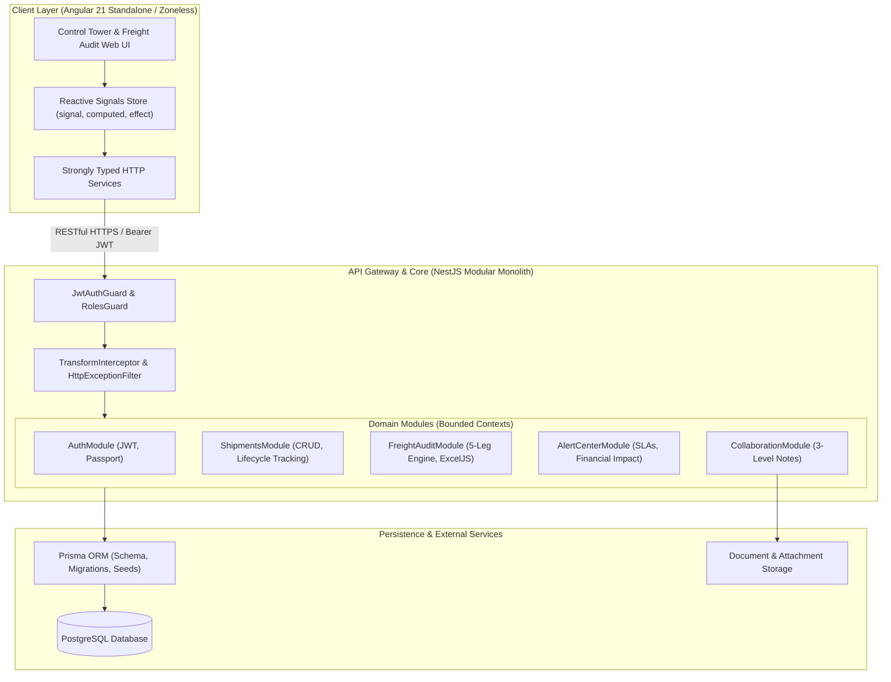

# CARGOPULSE — Enterprise Architecture Specification

> **Document Version:** 1.0.0  
> **Target Audience:** Engineering Leadership, Full-Stack Developers, Technical Auditors  
> **Repository Pattern:** Modular Monolith in a Single Monorepo  

---

## 1. System Overview & Business Problem

**CargoPulse** is an enterprise-grade **Logistics Control Tower and Multi-Stage Freight Audit SaaS Platform**. Built for multimodal supply chain operators moving cross-border freight, CargoPulse solves three industry-critical challenges:

1. **Topological Network Blindness:** Lack of real-time directed graph visibility into shipments navigating multi-node routes (Origin plants $\rightarrow$ Customs / Border checkpoints $\rightarrow$ Destination warehouses).
2. **Freight Cost Leakage & Tariff Variance:** Carriers and trucking lines billing rates that deviate from contracted spot or master service agreement (MSA) rates across individual route legs.
3. **Unresolved Operational Incidencias & SLA Breaches:** Delayed border crossings, customs holds, and equipment breakdowns accumulating financial loss without granular countdown timers or root-cause tracking.



---

## 2. Monorepo Structural Topology

```text
CargoPulse/
├── apps/
│   ├── api/                           # NestJS Modular Monolith API
│   │   ├── src/
│   │   │   ├── core/                  # Global Guards, Interceptors, Filters, Decorators
│   │   │   ├── database/              # Prisma schema, migrations, seed script
│   │   │   ├── modules/               # Independent domain bounded contexts
│   │   │   │   ├── auth/              # JWT authentication & session management
│   │   │   │   ├── shipments/         # Shipment entity management & status engine
│   │   │   │   ├── freight-audit/     # 5-leg audit variance calculations & ExcelJS export
│   │   │   │   ├── alert-center/      # SLA dynamic countdowns & financial impact tracker
│   │   │   │   └── collaboration/     # 3-level hierarchical communication tree
│   │   │   ├── app.module.ts
│   │   │   └── main.ts
│   │   ├── Dockerfile
│   │   └── package.json
│   │
│   └── web/                           # Angular 21 Standalone Zoneless Client
│       ├── src/
│       │   ├── app/
│       │   │   ├── core/              # Global singletons, AuthStore, HTTP Interceptors
│       │   │   ├── shared/            # Dumb reusable UI components, pipes, directives
│       │   │   ├── features/          # Domain feature pages
│       │   │   │   ├── control-tower/ # Interactive DAG network topology (@swimlane/ngx-graph)
│       │   │   │   ├── freight-audit/ # 5-stage reconciliation grid with ExcelJS export
│       │   │   │   ├── alert-center/  # SLA live countdown board and resolution drawer
│       │   │   │   └── shipments/     # Reactive shipment CRUD & tracking view
│       │   │   ├── app.routes.ts
│       │   │   └── app.config.ts
│       ├── Dockerfile
│       └── package.json
│
├── e2e/                               # End-to-End Test Suite (Playwright)
├── .github/
│   └── workflows/
│       └── ci.yml                     # Continuous Integration (Lint, Build, E2E)
├── docker-compose.yml                 # Orchestration for PostgreSQL + API + Web
├── ARCHITECTURE.md                    # Technical Architecture Document (This file)
├── ROADMAP.md                         # Sprint by Sprint Execution Checklist
└── PROJECT_BLUEPRINT.md               # Master Project Blueprint & Specifications
```

---

## 3. Engineering Constitution & Inviolable Principles

### 3.1 Single Responsibility Principle (SRP) Across the Full Stack
- **Angular UI Components:** Presentation-only. They project data and emit user interactions. No direct HTTP calls or state mutation logic in components.
- **Signals Stores:** Manage feature state reactively via Angular Signals (`signal()`, `computed()`).
- **HTTP Services:** Pure HTTP clients returning strongly typed Observables or Promises.
- **NestJS Controllers:** Clean entry points handling routing, parameter extraction, and DTO validation (`ValidationPipe`). Business logic is strictly delegated to services.
- **NestJS Domain Services:** Encapsulate all domain business rules, variance calculations, and transactional database queries.

### 3.2 Frontend Technical Guidelines (Angular 21)
1. **100% Standalone:** No `NgModules` permitted.
2. **Native Zoneless:** Built on `provideExperimentalZonelessChangeDetection()`. No `zone.js` runtime overhead.
3. **Signal-Driven Reactivity:** State, computed derivations, and cross-component communication are powered by Signals (`signal()`, `computed()`, `effect()`).
4. **Modern Control Flow:** Exclusive use of `@if`, `@else`, `@for` (with required `track`), `@empty`, and `@defer (on viewport)`.
5. **Modern Styling:** Tailwind CSS utility styling for professional, clean, responsive UI with zero legacy CSS framework baggage.

### 3.3 Backend Technical Guidelines (NestJS)
1. **Strict TypeScript & Zero `any`:** All DTOs, parameters, and entities must have explicit interfaces and classes.
2. **Automatic Request Validation:** Global `ValidationPipe` with `{ whitelist: true, forbidNonWhitelisted: true, transform: true }` enforcing `class-validator` rules.
3. **OpenAPI / Swagger:** Comprehensive decorators (`@ApiTags()`, `@ApiOperation()`, `@ApiResponse()`) exposing live interactive documentation at `/api/docs`.
4. **Normalized Envelopes:** All responses wrapped via a global `TransformInterceptor`:
   ```json
   {
     "success": true,
     "data": {},
     "timestamp": "2026-10-16T20:30:00.000Z"
   }
   ```
5. **Centralized Error Handling:** Standardized error responses using `HttpExceptionFilter`.

### 3.4 Data & Persistence (Prisma ORM + PostgreSQL)
- **Declarative Schema:** Managed in `apps/api/src/database/schema.prisma`.
- **Relational Integrity:** Foreign keys, cascades, indices on tracking codes, and timestamp auditing (`createdAt`, `updatedAt`).
- **Seed Scenarios:** Comprehensive seed script (`seed.ts`) populating real-world multimodal freight scenarios (customs holds, tariff variances, multi-tier comments).

---

## 4. The 5-Leg Freight Audit Engine

The freight audit module calculates variances across 5 sequential logistics stages:
1. **Leg 1: Origin Handling & Inland Pickup**
2. **Leg 2: International Transit 1 (Port / Border Approach)**
3. **Leg 3: Customs Clearance & Border Crossing**
4. **Leg 4: International Transit 2 (Inland Haulage to Region)**
5. **Leg 5: Final Mile Delivery to Destination Facility**

$$\text{Variance} = \text{ActualCost} - \text{ContractedCost}$$
$$\text{Variance Percentage} = \left(\frac{\text{ActualCost} - \text{ContractedCost}}{\text{ContractedCost}}\right) \times 100$$

- **Green Status ($\le 0\%$):** Actual cost at or under contracted cost.
- **Amber Status ($0\% < \text{Variance} \le 5\%$):** Minor deviation within tolerance.
- **Red Status ($> 5\%$):** Tariff breach requiring audit dispute and managerial sign-off.
