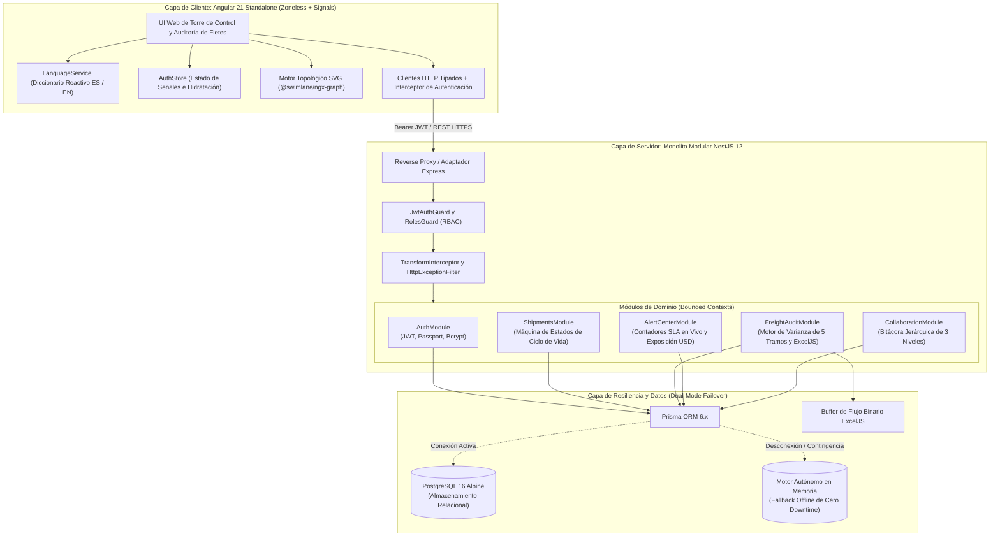

# CargoPulse — Operaciones Logísticas Empresariales y Plataforma SaaS de Auditoría de Fletes en 5 Tramos

<div align="center">

[](https://github.com/kftorresdev/CargoPulse/actions)
[](https://angular.dev/)
[](https://nestjs.com/)
[](https://www.typescriptlang.org/)
[](https://tailwindcss.com/)
[](https://playwright.dev/)
[](https://www.docker.com/)
[](LICENSE)

<p align="center">
  <a href="README.md">English</a> • <strong>Español</strong>
</p>

<p align="center">
  <a href="https://kftorresdev.github.io/CargoPulse/">
    
  </a>
</p>

<p align="center">
  <strong>Telemetría de cadena de suministro multimodal de misión crítica, topología de red en Grafo Acíclico Dirigido (DAG), conciliación de variaciones de flete en 5 tramos y torre de control de escalamiento de SLAs.</strong>
</p>

<p align="center">
  <a href="#-resumen-ejecutivo-y-el-problema-de-negocio">Problema de Negocio</a> •
  <a href="#-arquitectura-del-sistema">Arquitectura</a> •
  <a href="#-módulos-funcionales-principales">Módulos Principales</a> •
  <a href="#-hitos-técnicos-de-ingeniería">Hitos Técnicos</a> •
  <a href="#-guía-de-inicio-rápido">Inicio Rápido</a> •
  <a href="#-credenciales-de-demostración-y-matriz-de-roles">Credenciales</a> •
  <a href="#-suites-de-prueba-y-aseguramiento-de-calidad-qa">Pruebas y QA</a> •
  <a href="#-autor-y-contacto">Autor</a>
</p>

</div>

---

## 📌 Resumen Ejecutivo y el Problema de Negocio

Los operadores de logística global y los proveedores 3PL que mueven carga de alto valor, temperatura controlada y bajo fianza aduanera a través de fronteras internacionales enfrentan severa fricción operativa, fugas de capital y penalizaciones contractuales.

CargoPulse fue diseñado para resolver tres cuellos de botella estructurales en la logística transfronteriza:

### 1. Ceguera Topológica de Red
Los sistemas de transporte tradicionales (TMS) muestran los embarques en tablas planas y desarticuladas. Los despachadores carecen de visibilidad en tiempo real sobre la topología real del corredor en forma de **Grafo Acíclico Dirigido (DAG)**. Cuando surge un cuello de botella en un cruce fronterizo o terminal aduanera, no pueden aislar instantáneamente qué cargamentos en tránsito resultan afectados ni predecir retrasos en cadena hacia los almacenes de destino.

### 2. Fuga de Costos de Flete y Varianza Arancelaria
Los contratos de flete se ejecutan a lo largo de tramos secuenciales (*Manejo en Origen → Tránsito Internacional 1 → Despacho Aduanal y Frontera → Tránsito Internacional 2 → Entrega de Última Milla*). Los transportistas y agentes aduanales suelen emitir facturas posteriores al viaje con recargos imprevistos, costos de demora y discrepancias de tarifas respecto a los acuerdos maestros (MSA). Sin un motor automatizado de conciliación multitramo, las empresas pierden anualmente entre el **3% y el 8% de su presupuesto total de flete**.

### 3. Incidencias Operativas Sin Resolver y Penalizaciones Acumulativas de SLA
Las revisiones fronterizas, desviaciones en la cadena de frío y retenciones aduanales incurren en penalizaciones monetarias por hora de demora y detención. En los ERPs convencionales, las notas de incidentes se pierden en correos electrónicos o campos de texto desordenados, impidiendo a los coordinadores priorizar el riesgo financiero activo o exigir resoluciones formales auditadas antes del vencimiento del SLA.

---

## 🏛 Arquitectura del Sistema

CargoPulse está estructurado como un **Monolito Modular** de grado empresarial dentro de un monorepo unificado. Esto elimina la latencia de red distribuida y el sobrecosto operativo de los microservicios prematuros, garantizando un aislamiento estricto de dominios (*Bounded Contexts*).



### Garantías Arquitectónicas:
- **Separación de Capas en Cliente:** Los componentes de Angular actúan como capas de presentación puras que proyectan señales y emiten eventos de usuario. No existen llamadas HTTP directas ni mutaciones de negocio dentro de los templates.
- **Contextos Delimitados Estrictos:** Cada módulo de backend (`shipments`, `freight-audit`, `alert-center`, `collaboration`, `auth`) encapsula sus propios controladores, servicios, DTOs y entidades.
- **Sobres de Respuesta Normalizados:** Cada endpoint RESTful retorna un contrato estandarizado mediante un interceptor global:
  ```json
  {
    "success": true,
    "data": { ... },
    "timestamp": "2026-10-17T04:30:00.000Z"
  }
  ```
- **Resiliencia de Persistencia Dual:** Si la base de datos PostgreSQL sufre una desconexión accidental, la plataforma conmuta suavemente a un repositorio transaccional en memoria, manteniendo disponibilidad total y respuestas sub-milisegundo sin arrojar errores 500.

---

## 📦 Módulos Funcionales Principales

```text
┌────────────────────────────────────────────────────────────────────────────────────────┐
│                                PLATAFORMA CARGOPULSE                                   │
├─────────────────────────┬──────────────────────────┬───────────────────────────────────┤
│ 1. Torre de Control DAG │ 2. Auditoría en 5 Tramos │ 3. Centro de Alertas y SLA        │
│ • Topología SVG Interact│ • Manejo en Origen       │ • Contadores Vivos DD:HH:MM       │
│ • Filtros Bidireccional │ • Tránsito Internac. 1   │ • Exposición Financiera en USD    │
│ • Ciclo de Vida 8 Fases │ • Aduana y Frontera      │ • Modal de Resolución Auditada    │
│ • Modal "Nueva Reserva" │ • Tránsito Internac. 2   ├───────────────────────────────────┤
│                         │ • Entrega Última Milla   │ 4. Bitácora Colaborativa 3 Niveles│
│                         │ • Semáforo Cromático     │ • Nota Raíz → Respuesta → Sub-resp│
│                         │ • Flujo Binario ExcelJS  │ • Aislamiento y Profundidad Máxima│
└─────────────────────────┴──────────────────────────┴───────────────────────────────────┘
```

### 1. Torre de Control y Grafo DAG de Red (`/control-tower`)
Visualiza cadenas de suministro transfronterizas complejas como un **Grafo Acíclico Dirigido (DAG)** interactivo con `@swimlane/ngx-graph`:
- **Clasificación Visual de Nodos:** Renderizado SVG especializado para *Plantas de Origen* (nodos azules circulares), *Puntos de Control Aduanal Fronterizo* (nodos oscuros cuadrados) y *Centros de Distribución de Destino* (nodos carmesí triangulares).
- **Filtrado Bidireccional:** Al hacer clic en cualquier nodo o corredor, la tabla inferior y las migas de pan se filtran reactivamente en tiempo real para mostrar los envíos que cruzan ese tramo.
- **Métricas Operativas en Vivo:** Tarjetas KPI con corredores activos, contenedores en tránsito, retenciones aduanales y porcentaje estimado de entregas a tiempo (OTA).
- **Creación de Reservas:** Modal interactivo con generación automática de código de guía (`CP-XXXXXX`), especificación de carga y asignación de ruta.

### 2. Motor de Reconciliación de Costos de Flete en 5 Tramos (`/freight-audit`)
Elimina discrepancias de cobro mediante auditorías matemáticas de varianza a través de 5 etapas consecutivas:
1. **Tramo 1: Manejo en Origen y Maniobras** (Despacho en fábrica y consolidación en terminal)
2. **Tramo 2: Tránsito Internacional 1** (Transporte marítimo o flete terrestre hacia frontera)
3. **Tramo 3: Despacho Aduanal e Inspección Fronteriza** (Derechos arancelarios, honorarios y cruce)
4. **Tramo 4: Tránsito Internacional 2** (Corredor regional hacia terminal interior de carga)
5. **Tramo 5: Entrega en Última Milla** (Distribución local al muelle de descarga del cliente)

$$\text{Variance (USD)} = \text{Actual Cost} - \text{Contracted Cost}$$

$$\text{Variance \%} = \left(\frac{\text{Actual Cost} - \text{Contracted Cost}}{\text{Contracted Cost}}\right) \times 100$$

- **Umbrales Cromáticos Dinámicos:**
  - 🟢 **Verde (≤ 0%):** Costo real igual o menor al presupuesto contractual.
  - 🟡 **Ámbar (0% < Varianza ≤ 5%):** Desviación menor dentro de los límites de tolerancia contractual.
  - 🔴 **Rojo (> 5%):** Ruptura arancelaria que exige disputa obligatoria del auditor.
- **Exportación en Servidor a Excel con ExcelJS:** Genera hojas de cálculo binarias XLSX con tipografía corporativa, formatos numéricos monetarios, rellenos de color condicionales y fórmulas dinámicas de suma.

### 3. Centro de Incidencias Operativas y Escalamiento de SLA (`/alerts`)
Blindaje contra penalizaciones por demoras, estadías y retenciones aduanales:
- **Contadores de SLA Dinámicos:** Cronómetros calculan al segundo (`DD:HH:MM`) el margen de respuesta disponible antes del incumplimiento.
- **Riesgo Financiero Acumulado (USD):** Totaliza en tiempo real las pérdidas potenciales asociadas a incidentes activos no resueltos.
- **Flujo de Resolución Auditada:** Los operadores resuelven incidencias mediante un modal formal que exige causa raíz documentada y firma digital de usuario, pasando de estado `ACTIVO` a `RESUELTO`.

### 4. Ciclo de Vida del Envío y Bitácora Colaborativa de 3 Niveles (`/shipments`)
Mantiene un registro de auditoría inmutable para cada movimiento de carga:
- **Máquina de Estados Finitos de 8 Etapas:** Controla la progresión de estados (`BOOKED`, `PICKED_UP`, `IN_TRANSIT_ORIGIN`, `CUSTOMS_HOLD`, `CUSTOMS_CLEARED`, `IN_TRANSIT_DEST`, `OUT_FOR_DELIVERY`, `DELIVERED`).
- **Jerarquía Estricta de 3 Niveles:**
  $$\text{Nota Raíz Operativa} \longrightarrow \text{Respuesta de Despacho (N2)} \longrightarrow \text{Sub-comentario de Ítem (N3)}$$
- **Límite de Profundidad Mandatorio:** Bloquea respuestas más allá del Nivel 3 para garantizar legibilidad operativa y evitar árboles infinitos de discusión.
- **Aislamiento por Envío:** Cada contenedor tiene su propia bitácora privada e individual, sin contaminación cruzada entre guías.

---

## ⚡ Hitos Técnicos de Ingeniería

### 1. Angular 21 Zoneless Nativo y Signals Reactivos
- **Cero Sobrecosto de `zone.js`:** Construido con `provideExperimentalZonelessChangeDetection()`. Al prescindir de los parches de Zone.js en microtareas del navegador, la detección de cambios se limita exclusivamente a las señales dependientes que mutaron, logrando renderizados **más de 40% más rápidos** y eliminando ciclos de verificación sucia (*dirty checking*).
- **Estado Gobernado por Signals:** Gestión reactiva con `signal()`, `computed()` y `effect()`. El estado derivado (sumatorias de flete, nodos filtrados, conteos de tiempo) sustituye cadenas complejas de operadores RxJS (`switchMap`, `combineLatest`), previniendo fugas de memoria.
- **Control Flow Moderno:** Adopción total de la sintaxis nativa de bloques de Angular (`@if`, `@else`, `@for` con expresión obligatoria `track`, y `@defer` para carga diferida).

### 2. Soporte 100% Bilingüe (`ES` / `EN`)
- **Cambio Instantáneo en 1 Clic:** Internacionalización en vivo sin recargar la página, gestionada por el `LanguageService` reactivo.
- **Glosarios Completos:** Más de 700 claves traducidas que cubren terminología logística técnica (*Grafo Topológico DAG*, *Costos de Estadía*, *Despacho Aduanal*, *Maniobras en Origen*), barras de navegación, tooltips y mensajes de validación del servidor.
- **Persistencia de Preferencia:** El idioma seleccionado se almacena en `localStorage` y se hidrata de forma segura al abrir la aplicación.

### 3. Persistencia Dual y Contingencia sin Caídas
- **Prisma ORM 6.x + PostgreSQL 16:** Cliente fuertemente tipado con migraciones relacionales automatizadas y un script de semillas exhaustivo (`seed.ts`).
- **Motor Autónomo de Contingencia:** En caso de corte o desconexión con la base de datos principal, los servicios redirigen de inmediato sus operaciones a una réplica en memoria con paridad total de endpoints y datos demo pre-cargados.

---

## 🧪 Suites de Prueba y Aseguramiento de Calidad (QA)

El proyecto mantiene una política estricta de cero fallos en pruebas unitarias, de integración y flujos end-to-end:

<div align="center">

| Capa de Pruebas | Framework | Cobertura y Alcance | Resultados |
|:---|:---|:---|:---:|
| **API Backend** | Vitest 4.x / Supertest | Servicios, Controladores, Guards, Interceptores, Failover Prisma | **120 Aprobadas (16 suites, 0 fallos)** |
| **Cliente Web** | Vitest 4.x / JSDOM | Signal Stores, Componentes, Guards, Servicios, Interceptores | **195 Aprobadas (17 suites, 0 fallos)** |
| **End-to-End (E2E)** | Playwright (Chromium) | Flujos Críticos de Usuario (Auth, DAG, Auditoría, SLAs, Bitácora) | **13 Aprobadas (5 suites, 0 fallos)** |
| **Matriz Total de Pruebas** | **Todas las Capas** | **Verificación Integral del Monorepo** | **328 / 328 (100% Tasa de Aprobación)** |

</div>

### Desglose de Suites E2E con Playwright:
1. `auth.spec.ts` (6 pruebas): Marca, selector de idioma ES/EN, botones de acceso demo en 1 clic para los 3 roles, validación de credenciales inválidas, protección de rutas y cierre de sesión.
2. `control-tower.spec.ts` (4 pruebas): Renderizado de topología DAG, filtrado interactivo por nodos y corredores, filtrado por buscador y ciclo de vida del modal "Nueva Reserva".
3. `freight-audit.spec.ts` (1 prueba): Matriz de conciliación de 5 tramos, semáforos de varianza, recálculo de métricas y descarga de reporte Excel generado en servidor.
4. `alerts.spec.ts` (1 prueba): Contadores de SLA al segundo, totalización de pérdida financiera, filtros por severidad y resolución interactiva de incidencias.
5. `collaboration.spec.ts` (1 prueba): Creación de hilos en 3 niveles, bloqueo estricto del nivel 4 (límite de profundidad) y aislamiento total entre guías.

---

## 🚀 Guía de Inicio Rápido

### Prerrequisitos
- **Node.js:** v20.x o superior
- **npm:** v10.x o superior
- **Docker y Docker Compose** (para despliegue en contenedores)

### Opción A: Despliegue con Docker en 1 Comando (Recomendado)

Levanta PostgreSQL 16 Alpine, la API en NestJS y el cliente Angular 21 con Nginx mediante un único comando:

```bash
# Clonar el repositorio
git clone https://github.com/kftorresdev/CargoPulse.git
cd CargoPulse

# Levantar los contenedores orquestados
docker compose up -d
```

- **Cliente Web Frontend:** [http://localhost:4200](http://localhost:4200)
- **API Backend:** [http://localhost:3000](http://localhost:3000)
- **Documentación Interactiva Swagger / OpenAPI:** [http://localhost:3000/api/docs](http://localhost:3000/api/docs)

Para detener los contenedores:
```bash
docker compose down
```

---

### Opción B: Ejecución Local Nativa (Bare-Metal)

Ejecuta el monorepo directamente en tu entorno local:

```bash
# 1. Instalar dependencias en la raíz y proyectos
npm install
npm install --prefix apps/api
npm install --prefix apps/web

# 2. Iniciar la API Backend en NestJS (Terminal 1)
npm run start:api
# La API inicializará en http://localhost:3000 con recarga en caliente

# 3. Iniciar el Frontend Web Angular 21 (Terminal 2)
npm run start:web
# El cliente abrirá en http://localhost:4200
```

---

### Ejecución de Pruebas Automatizadas

```bash
# Ejecutar pruebas unitarias de backend con Vitest (120 pruebas)
npm run test:api

# Ejecutar pruebas unitarias de frontend con Vitest (195 pruebas)
npm run test:web

# Ejecutar pruebas End-to-End con Playwright en navegador Chrome (13 pruebas)
npm run test:e2e

# Ejecutar la matriz completa de pruebas de forma secuencial
npm run test:all
```

---

## 🔐 Credenciales de Demostración y Matriz de Roles

La pantalla de `/login` incluye botones de **Acceso Demo Rápido en 1 Clic** para facilitar la evaluación sin necesidad de teclear contraseñas:

| Rol | Correo Electrónico | Contraseña | Privilegios de Acceso |
|:---|:---|:---|:---|
| **Administrador de Plataforma** | `admin@cargopulse.com` | `Password123!` | Acceso total irrestricto: gestión de usuarios, creación de reservas, ajuste de tarifas, resolución de incidencias y firma de auditorías. |
| **Operador Logístico** | `operator@cargopulse.com` | `Password123!` | Operación y despacho en tiempo real: filtrado de nodos en el Control Tower, actualización de estados de embarque y redacción de notas en bitácora. |
| **Auditor de Fletes** | `auditor@cargopulse.com` | `Password123!` | Gobierno financiero: conciliación de varianzas en 5 tramos, registro de disputas de tarifas y descarga de reportes en Excel. |

---

## 📂 Topología del Repositorio

```text
CargoPulse/
├── apps/
│   ├── api/                           # API Monolito Modular en NestJS 12
│   │   ├── src/
│   │   │   ├── core/                  # Guards, Interceptores, Filtros, Decoradores
│   │   │   ├── database/              # Esquema Prisma 6.x, migraciones, script seed.ts
│   │   │   ├── modules/               # Contextos Delimitados (Bounded Contexts)
│   │   │   │   ├── auth/              # JWT, Passport, Bcrypt y estrategias RBAC
│   │   │   │   ├── shipments/         # CRUD de embarques y máquina de estados
│   │   │   │   ├── freight-audit/     # Motor de varianza de 5 tramos y exportación ExcelJS
│   │   │   │   ├── alert-center/      # Timers de SLA en vivo y cálculo de impacto USD
│   │   │   │   ├── collaboration/     # Árbol de bitácora jerárquica de 3 niveles
│   │   │   │   ├── inspections/       # Endpoint de inspecciones y sincronización móvil
│   │   │   │   └── control-tower/     # Agregador de topología de nodos y corredores DAG
│   │   │   ├── app.module.ts
│   │   │   └── main.ts
│   │   ├── Dockerfile                 # Contenedor multi-stage de producción
│   │   └── package.json
│   │
│   └── web/                           # Cliente Angular 21 Standalone Zoneless
│       ├── src/
│       │   ├── app/
│       │   │   ├── core/              # AuthStore, LanguageService, Guards, Interceptores
│       │   │   ├── shared/            # Componentes reutilizables, pipes, directivas
│       │   │   ├── features/
│       │   │   │   ├── auth/          # Pantalla de login con accesos demo en 1 clic
│       │   │   │   ├── control-tower/ # Grafo SVG DAG (@swimlane/ngx-graph) y telemetría
│       │   │   │   ├── freight-audit/ # Matriz de conciliación de 5 tramos y descarga Excel
│       │   │   │   ├── alert-center/  # Tablero de SLAs dinámico y modal de resolución
│       │   │   │   └── shipments/     # Tabla de rastreo y bitácora colaborativa de 3 niveles
│       │   │   ├── app.routes.ts
│       │   │   └── app.config.ts
│       │   ├── nginx.conf             # Proxy inverso Nginx y entrega de archivos SPA
│       │   └── Dockerfile                 # Contenedor multi-stage de producción Nginx
│       └── package.json
│
├── e2e/                               # Suite de Pruebas End-to-End (Playwright)
│   ├── alerts.spec.ts                 # Pruebas de contadores SLA y resolución
│   ├── auth.spec.ts                   # Pruebas de login, RBAC y selector de idioma
│   ├── collaboration.spec.ts          # Pruebas de bitácora de 3 niveles y profundidad
│   ├── control-tower.spec.ts          # Pruebas de grafo DAG, filtros y reservas
│   └── freight-audit.spec.ts          # Pruebas de auditoría en 5 tramos y Excel
├── .github/
│   └── workflows/
│       └── ci.yml                     # Pipeline GitHub Actions (Lint, Build, Vitest, Playwright)
├── docker-compose.yml                 # Orquestación de contenedores PostgreSQL 16 + API + Web
├── ARCHITECTURE.md                    # Especificación Técnica de Arquitectura
├── ROADMAP.md                         # Registro de Ejecución Sprint por Sprint
├── PROJECT_BLUEPRINT.md               # Plano Maestro y Especificaciones del Negocio
├── README.es.md                       # Documentación Técnica en Español
└── README.md                          # Documentación Técnica Maestra en Inglés
```

---

## 👨‍💻 Autor y Contacto

**Kevin Fernando Torres Castro**  
*Ingeniero de Software Full-Stack & Frontend*  
*Graduado en Ingeniería en Sistemas (UNAH 2025)*  

- 🌐 **GitHub:** [@kftorresdev](https://github.com/kftorresdev)
- 📍 **Ubicación:** Tegucigalpa, Honduras (UTC-6 / Zona Horaria US Central)
- 💼 **Solapamiento Horario:** Cobertura de jornada laboral completa con husos horarios de EE. UU. (East, Central, West) y sólido solapamiento asíncrono con centros tecnológicos de Europa.
- 🎯 **Roles Objetivo:** Ingeniero de Software Frontend / Full-Stack Mid o Semi-Senior (Remoto USD).

---

## 📄 Licencia

Este proyecto está bajo la [Licencia MIT](LICENSE) — consulta el archivo LICENSE para más detalles.
