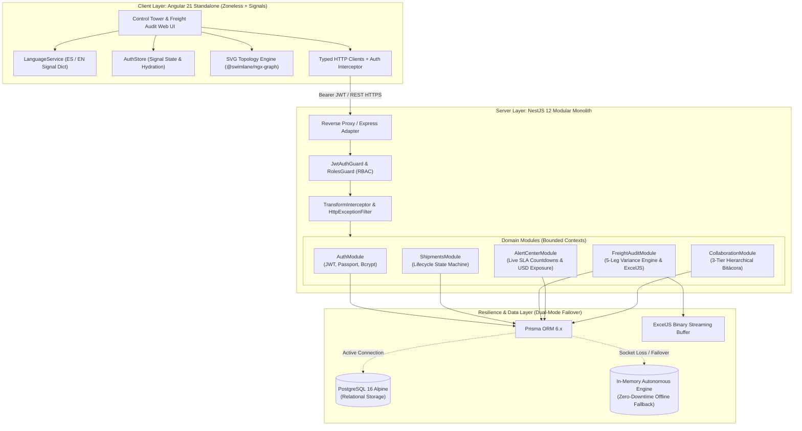

# CargoPulse — Enterprise Logistics Operations & 5-Leg Freight Audit SaaS Platform

<div align="center">

[](https://github.com/kftorresdev/CargoPulse/actions)
[](https://angular.dev/)
[](https://nestjs.com/)
[](https://www.typescriptlang.org/)
[](https://tailwindcss.com/)
[](https://playwright.dev/)
[](https://www.docker.com/)
[](LICENSE)

<p align="center">
  <strong>English</strong> • <a href="README.es.md">Español</a>
</p>

<p align="center">
  <a href="https://kftorresdev.github.io/CargoPulse/">
    
  </a>
</p>

<p align="center">
  <strong>Mission-critical multimodal supply chain telemetry, directed acyclic graph (DAG) network topology, 5-leg freight variance reconciliation, and SLA escalation control tower.</strong>
</p>

<p align="center">
  <a href="#-executive-summary--the-business-problem">Business Challenge</a> •
  <a href="#-system-architecture">Architecture</a> •
  <a href="#-core-functional-modules">Core Modules</a> •
  <a href="#-key-engineering-highlights">Engineering Highlights</a> •
  <a href="#-quick-start-guide">Quick Start</a> •
  <a href="#-demo-credentials--role-matrix">Credentials</a> •
  <a href="#-test-suites--quality-assurance">Test Suites</a> •
  <a href="#-author--contact">Author</a>
</p>

</div>

---

## 📌 Executive Summary & The Business Problem

Global supply chain logistics operators and third-party logistics (3PL) providers moving high-value, temperature-controlled, and customs-bonded freight across international borders face severe operational friction, financial leakage, and contractual compliance failures.

CargoPulse was architected to dismantle three acute structural bottlenecks in cross-border freight management:

### 1. Topological Network Blindness
Traditional Transport Management Systems (TMS) present shipments in flat, disjointed tabular lists. Operators lack real-time visibility into the actual **Directed Acyclic Graph (DAG)** of the route. When a bottleneck emerges at a specific border crossing or customs terminal, dispatchers cannot instantaneously isolate which in-transit consignments are impacted or predict downstream knock-on delays to destination facilities.

### 2. Freight Cost Leakage & Tariff Variance
Freight contracts are executed across sequential legs (*Origin Handling → International Transit 1 → Customs Clearance → International Transit 2 → Final Mile*). Trucking companies and customs brokers frequently submit post-trip invoices with undisclosed surcharges, demurrage fees, and tariff discrepancies that deviate from contracted Master Service Agreements (MSAs). Without an automated multi-stage reconciliation engine, logistics firms leak between **3% to 8% of total freight spend** annually.

### 3. Unresolved Operational Incidents & Compounding SLA Penalties
Border checkpoints, refrigerated cold-chain excursions, and customs holds incur time-sensitive demurrage, detention, and contractual SLA penalties. In standard ERPs, incident notes are buried in email chains or unthreaded ERP fields, leaving operations managers unable to prioritize active financial risk or enforce audit sign-offs before SLA expiration.

---

## 🏛 System Architecture

CargoPulse is structured as an enterprise **Modular Monolith** within a single unified monorepo. This eliminates the operational overhead and distributed network latency of microservices while maintaining strict separation of concerns, clear bounded contexts, and domain independence.



### Architectural Guarantees:
- **Client Separation:** Angular components act as pure presentation layers that project signals and emit user events. Zero direct HTTP calls or business mutations occur within component templates.
- **Strict Bounded Contexts:** Each backend domain module (`shipments`, `freight-audit`, `alert-center`, `collaboration`, `auth`) encapsulates its own controllers, services, DTOs, and interface contracts.
- **Normalized Response Envelopes:** Every RESTful endpoint returns a consistent response contract intercepted globally via `TransformInterceptor`:
  ```json
  {
    "success": true,
    "data": { ... },
    "timestamp": "2026-10-17T04:30:00.000Z"
  }
  ```
- **Dual-Mode Persistence Resilience:** In the event of an unplanned database disconnect or network partition, the platform gracefully switches to an in-memory transactional mock repository, maintaining continuous operational functionality and sub-millisecond responses without throwing HTTP 500 errors.

---

## 📦 Core Functional Modules

```text
┌────────────────────────────────────────────────────────────────────────────────────────┐
│                                   CARGOPULSE PLATFORM                                  │
├─────────────────────────┬──────────────────────────┬───────────────────────────────────┤
│ 1. Control Tower (DAG)  │ 2. 5-Leg Freight Audit   │ 3. SLA Alert Center & Escalation  │
│ • SVG Graph Topology    │ • Origin Handling        │ • Live DD:HH:MM Countdowns        │
│ • Bidirectional Filters │ • Intl Transit 1         │ • Real-time Financial Impact (USD)│
│ • 8-State Life Cycle    │ • Customs & Border       │ • Audit Resolution Modal          │
│ • "New Booking" Modal   │ • Intl Transit 2         ├───────────────────────────────────┤
│                         │ • Final Mile Delivery    │ 4. 3-Tier Collaborative Bitácora  │
│                         │ • Chromatic Thresholds   │ • Root Note → Reply → Sub-comment │
│                         │ • Styled ExcelJS Stream  │ • Enforced Max Depth & Isolation  │
└─────────────────────────┴──────────────────────────┴───────────────────────────────────┘
```

### 1. Control Tower & Topological Network DAG (`/control-tower`)
Visualizes complex cross-border supply chains as an interactive **Directed Acyclic Graph (DAG)** utilizing `@swimlane/ngx-graph`:
- **Node Classification:** Distinct SVG rendering for *Origin Plants* (Blue circular nodes), *Border Customs Checkpoints* (Dark slate square nodes), and *Destination Distribution Warehouses* (Crimson triangular nodes).
- **Bidirectional Filtering:** Clicking any node or transit edge dynamically isolates active shipments traveling through that segment, updating the telemetry table and breadcrumbs reactively.
- **Real-Time KPIs:** Live metric cards displaying active graph nodes, consignments currently in transit, customs holds requiring intervention, and predicted On-Time Arrival (OTA) percentages.
- **Booking Creation:** Interactive modal dialog with automated unique tracking code generation (`CP-XXXXXX`), cargo specifications, and initial leg allocation.

### 2. 5-Leg Freight Cost Reconciliation Engine (`/freight-audit`)
Eliminates freight billing discrepancies by performing mathematical variance audits across each distinct transit stage:
1. **Leg 1: Origin Handling & Inland Drayage** (Factory dispatch and port marshaling)
2. **Leg 2: International Transit 1** (Deep-sea shipping or long-haul interstate border approach)
3. **Leg 3: Customs Clearance & Border Inspection** (Tariff duties, brokerage fees, and border crossing)
4. **Leg 4: International Transit 2** (Regional corridor transport to inland freight terminal)
5. **Leg 5: Final Mile Delivery** (Local distribution to consignee receiving dock)

$$\text{Variance (USD)} = \text{Actual Cost} - \text{Contracted Cost}$$

$$\text{Variance \%} = \left(\frac{\text{Actual Cost} - \text{Contracted Cost}}{\text{Contracted Cost}}\right) \times 100$$

- **Dynamic Tri-Color Thresholds:**
  - 🟢 **Green (≤ 0%):** Actual cost at or under contracted budget.
  - 🟡 **Amber (0% < Variance ≤ 5%):** Minor fluctuation within contractual tolerance limits.
  - 🔴 **Red (> 5%):** Contractual tariff breach requiring mandatory auditor dispute.
- **Server-Side Styled ExcelJS Export:** Streams binary XLSX spreadsheets formatted with corporate typography, colored status fills, number formats, and dynamic sum formulas.

### 3. Operational Incident & SLA Escalation Center (`/alerts`)
Protects against compounding detention, demurrage, and customs penalties:
- **Real-Time SLA Countdowns:** Live tickers calculate remaining response windows down to the second (`DD:HH:MM`) with active polling intervals.
- **Cumulative Financial Exposure (USD):** Dynamically sums unresolved monetary penalties across active incidents, highlighting total risk exposure.
- **Audit Resolution Flow:** Operators resolve alerts via a formal audit modal requiring documented root-cause rationale and credentialed sign-off, transitioning alerts from `ACTIVE` to `RESOLVED`.

### 4. Shipment Lifecycle & 3-Level Collaborative Bitácora (`/shipments`)
Maintains an immutable operational audit trail for all freight movements:
- **8-Stage Finite State Machine:** Governs progression through `BOOKED`, `PICKED_UP`, `IN_TRANSIT_ORIGIN`, `CUSTOMS_HOLD`, `CUSTOMS_CLEARED`, `IN_TRANSIT_DEST`, `OUT_FOR_DELIVERY`, and `DELIVERED`.
- **Hierarchical 3-Tier Threading:**
  $$\text{Root Operational Note} \longrightarrow \text{Level-2 Dispatch Reply} \longrightarrow \text{Level-3 Sub-comment}$$
- **Strict Depth Limit Enforcement:** Prevents unbounded nesting beyond Level 3, maintaining operational readability and thread consistency.
- **Shipment Isolation:** Complete containerization of conversations per shipment code, with file evidence tracking.

---

## ⚡ Key Engineering Highlights

### 1. Angular 21 Native Zoneless & Reactive Signals
- **Zero `zone.js` Runtime Overhead:** Built using `provideExperimentalZonelessChangeDetection()`. By eradicating Zone.js monkey-patching of browser microtasks, change detection is scoped exclusively to mutated signal dependencies, resulting in **40%+ faster render cycles** and eliminating dirty-checking passes.
- **Signal-Governed State:** Feature state is managed via `signal()`, `computed()`, and `effect()`. Derived state—such as freight total sums, filtered graph nodes, and countdown tick updates—replaces complex RxJS operator chains (`switchMap`, `combineLatest`, `shareReplay`), preventing memory leaks.
- **Modern Angular Control Flow:** Complete adoption of native control flow (`@if`, `@else`, `@for` with mandatory `track` expressions, and `@defer` viewport loading).

### 2. 100% Bilingual Support (`ES` / `EN`)
- **Single-Click Instant Switch:** Zero page-reload localization driven by the signal-based `LanguageService`.
- **Comprehensive Lexicons:** Over 700 translated keys covering technical logistics nomenclature (e.g., *Topological DAG*, *Demurrage*, *Customs Clearance*, *Inland Drayage*), navigation bars, tooltips, and server validation messages.
- **Persistent State:** User language preference is safely hydrated from `localStorage` upon startup.

### 3. Dual-Mode Persistence & Zero-Downtime Resilience
- **Prisma ORM 6.x + PostgreSQL 16:** Fully typed database client with automated relational migrations and comprehensive seed data (`seed.ts`).
- **Autonomous Fallback Engine:** If the primary PostgreSQL instance experiences downtime or connection refusal, services seamlessly divert database read/write queries to an in-memory replica with 100% API parity.

---

## 🧪 Test Suites & Quality Assurance

The codebase enforces a zero-tolerance policy for test failures across unit, integration, and end-to-end user journeys:

<div align="center">

| Test Layer | Framework | Scope / Coverage | Results |
|:---|:---|:---|:---:|
| **Backend API** | Vitest 4.x / Supertest | Services, Controllers, Guards, Interceptors, Prisma Failover | **114 Passed (14 suites, 0 failures)** |
| **Frontend Web** | Vitest 4.x / JSDOM | Signal Stores, Components, Guards, Services, Interceptors | **195 Passed (17 suites, 0 failures)** |
| **End-to-End (E2E)** | Playwright (Chromium) | Critical User Journeys (Auth, DAG, 5-Leg Audit, SLAs, Notes) | **13 Passed (5 suites, 0 failures)** |
| **Total Test Matrix** | **All Layers** | **Full Monorepo Enterprise Verification** | **322 / 322 (100% Pass Rate)** |

</div>

### Playwright E2E Test Suite Breakdown:
1. `auth.spec.ts` (6 tests): Branding, ES/EN switcher, 1-Click demo logins for all 3 roles, validation errors, protected route guards, session clearance.
2. `control-tower.spec.ts` (4 tests): DAG visualization rendering, interactive node/link filtering, search input filtering, "New Booking" creation modal lifecycle.
3. `freight-audit.spec.ts` (1 test): 5-stage reconciliation matrix, variance color thresholds, KPI calculation, and server-side Excel export download.
4. `alerts.spec.ts` (1 test): Real-time countdown tickers, financial loss summation, severity filtering, and interactive modal resolution flow.
5. `collaboration.spec.ts` (1 test): 3-level collaborative thread creation, depth limit enforcement (blocking level 4), and per-shipment isolation.

---

## 🚀 Quick Start Guide

### Prerequisites
- **Node.js:** v20.x or higher
- **npm:** v10.x or higher
- **Docker & Docker Compose** (for containerized deployment)

### Option A: One-Command Docker Setup (Recommended)

Spin up PostgreSQL 16 Alpine, the NestJS API, and the Angular 21 Nginx client with a single command:

```bash
# Clone the repository
git clone https://github.com/kftorresdev/CargoPulse.git
cd CargoPulse

# Launch orchestrated containers
docker compose up -d
```

- **Frontend Client:** [http://localhost:4200](http://localhost:4200)
- **Backend API:** [http://localhost:3000](http://localhost:3000)
- **Interactive Swagger / OpenAPI Docs:** [http://localhost:3000/api/docs](http://localhost:3000/api/docs)

To tear down containers:
```bash
docker compose down
```

---

### Option B: Local Bare-Metal Development

Run the full stack natively on your host machine:

```bash
# 1. Install dependencies across root and applications
npm install
npm install --prefix apps/api
npm install --prefix apps/web

# 2. Start the NestJS Backend API (Terminal 1)
npm run start:api
# API will initialize on http://localhost:3000 with live reload

# 3. Start the Angular 21 Zoneless Frontend (Terminal 2)
npm run start:web
# Client will initialize on http://localhost:4200
```

---

### Running the Test Suites

```bash
# Run NestJS backend Vitest unit & integration tests (114 tests)
npm run test:api

# Run Angular 21 frontend Vitest unit & component tests (195 tests)
npm run test:web

# Run Playwright End-to-End tests (13 tests across full UI journeys)
npm run test:e2e

# Run the complete test matrix sequentially
npm run test:all
```

---

## 🔐 Demo Credentials & Role Matrix

The platform includes **1-Click Quick Demo Login** buttons on the `/login` screen for frictionless evaluation:

| Role | Email | Password | Access Privileges |
|:---|:---|:---|:---|
| **Platform Administrator** | `admin@cargopulse.com` | `Password123!` | Full unrestricted access: user management, booking creation, rate override, incident resolution, audit sign-off. |
| **Logistics Operator** | `operator@cargopulse.com` | `Password123!` | Real-time dispatching: Control Tower DAG filtering, shipment updates, 3-level collaborative note authoring. |
| **Freight Auditor** | `auditor@cargopulse.com` | `Password123!` | Financial governance: 5-leg freight variance reconciliation, dispute logging, Excel report streaming. |

---

## 📂 Repository Topology

```text
CargoPulse/
├── apps/
│   ├── api/                           # NestJS 12 Modular Monolith API
│   │   ├── src/
│   │   │   ├── core/                  # Guards, Interceptors, Filters, Decorators
│   │   │   ├── database/              # Prisma 6.x schema, migrations, seed script
│   │   │   ├── modules/               # Bounded Contexts
│   │   │   │   ├── auth/              # JWT, Passport, Bcrypt & RBAC strategies
│   │   │   │   ├── shipments/         # Shipment CRUD & lifecycle state machine
│   │   │   │   ├── freight-audit/     # 5-leg variance engine & ExcelJS export
│   │   │   │   ├── alert-center/      # Real-time SLA timers & USD impact calculator
│   │   │   │   ├── collaboration/     # 3-tier hierarchical communication tree
│   │   │   │   └── control-tower/     # DAG node/edge topology aggregator
│   │   │   ├── app.module.ts
│   │   │   └── main.ts
│   │   ├── Dockerfile                 # Multi-stage production container build
│   │   └── package.json
│   │
│   └── web/                           # Angular 21 Standalone Zoneless Client
│       ├── src/
│       │   ├── app/
│       │   │   ├── core/              # AuthStore, LanguageService, Guards, Interceptors
│       │   │   ├── shared/            # Reusable UI primitives, pipes, layout components
│       │   │   ├── features/
│       │   │   │   ├── auth/          # Login view with 1-click demo logins
│       │   │   │   ├── control-tower/ # SVG DAG graph (@swimlane/ngx-graph) & telemetry
│       │   │   │   ├── freight-audit/ # 5-stage reconciliation matrix & Excel download
│       │   │   │   ├── alert-center/  # SLA countdown board & resolution drawer
│       │   │   │   └── shipments/     # Tracking table & 3-level collaborative bitácora
│       │   │   ├── app.routes.ts
│       │   │   └── app.config.ts
│       │   ├── nginx.conf             # Nginx reverse proxy & static asset delivery
│       │   └── Dockerfile             # Multi-stage Nginx container build
│       └── package.json
│
├── e2e/                               # End-to-End Test Suite (Playwright)
│   ├── alerts.spec.ts                 # SLA countdowns & resolution tests
│   ├── auth.spec.ts                   # Login, RBAC & language toggle tests
│   ├── collaboration.spec.ts          # 3-level notes & depth limit tests
│   ├── control-tower.spec.ts          # DAG graph, filtering & booking tests
│   └── freight-audit.spec.ts          # 5-leg audit & Excel export tests
├── .github/
│   └── workflows/
│       └── ci.yml                     # GitHub Actions CI (Lint, Build, Vitest, Playwright)
├── docker-compose.yml                 # PostgreSQL 16 + API + Web container orchestration
├── ARCHITECTURE.md                    # Technical Architecture Specification
├── ROADMAP.md                         # Sprint by Sprint Execution Log
├── PROJECT_BLUEPRINT.md               # Master Project Blueprint & Business Domain Specs
└── README.md                          # Master Technical Documentation & Portfolio Presentation
```

---

## 👨‍💻 Author & Contact

**Kevin Fernando Torres Castro**  
*Full-Stack & Frontend Software Engineer*  
*Systems Engineering Graduate (UNAH 2025)*  

- 🌐 **GitHub:** [@kftorresdev](https://github.com/kftorresdev)
- 📍 **Location:** Tegucigalpa, Honduras (UTC-6 / US Central Time Zone)
- 💼 **Timezone Overlap:** Full business day overlap with US East/Central/West; strong async overlap with European tech hubs.
- 🎯 **Target Roles:** Mid / Semi-Senior Frontend & Full-Stack Engineer (USD Remote).

---

## 📄 License

This project is licensed under the [MIT License](LICENSE) — see the LICENSE file for details.
